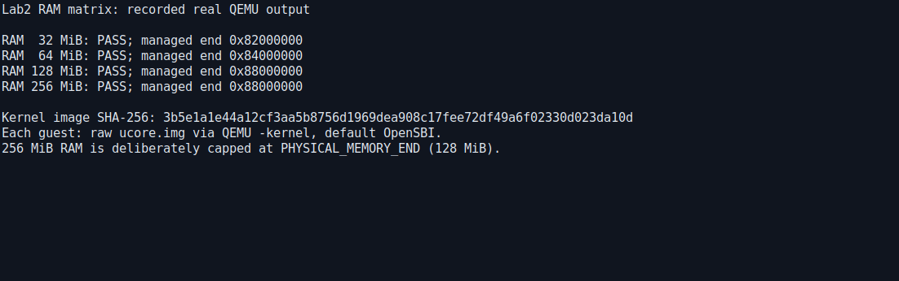
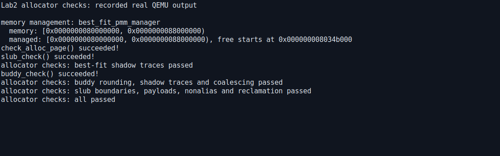
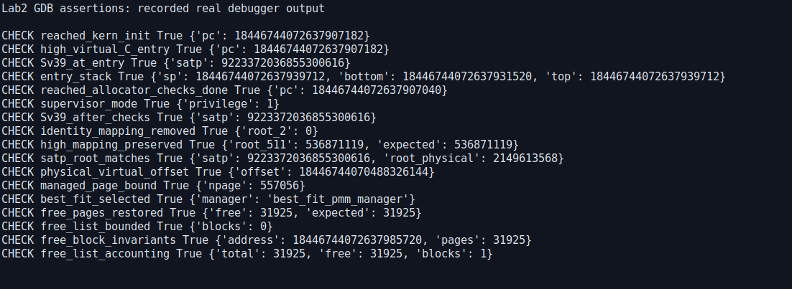
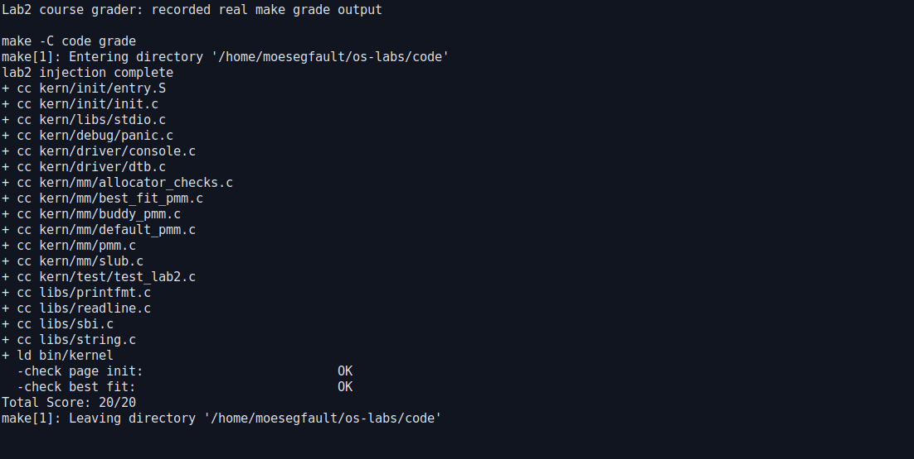

# Lab2：物理内存管理实验报告

## 实验基本信息

| 项目 | 内容 |
|---|---|
| 实验名称 | Lab2：物理内存发现、页分配与对象分配 |
| 小组成员 | 龙李宽-2413077 王艺霖-2410824 郭嘉睿-2413174  |
| 完成日期 | 2026-10-22（实现与验证记录日期） |
| 源码与报告 | `code/`、`report/`，实验分支 `lab2` |

### 小组分工

小组按以下三个任务分工；这里的任务一、任务二、任务三是小组工作包编号，不替代课程手册中的任务编号。成员姓名和学号待填写，代码中的 `YOUR CODE` 也须替换为真实学号，保留 `lab2` 标记。

| 任务 | 负责人 | 实验内容与测试职责 | 报告职责 |
|---|---|---|---|
| 任务一：物理内存初始化与连续页分配 | 龙李宽-2413077 | 负责 `pmm.c` 中的物理内存初始化，阅读分析 First-Fit，实现并接入 `best_fit_pmm.c`；负责内存边界、Best-Fit 选择、拆分与合并测试，以及课程评分、不同内存配置和 GDB 验证的复现与结果汇总 | 负责第 3 节整体逻辑、第 4.1—4.3 节和第 4.6 节 Challenge，整理对应提示词；汇总环境、验证结果与最终报告 |
| 任务二：Buddy 伙伴系统 | 王艺霖-2410824 | 负责 `buddy_pmm.c`、`buddy_pmm.h`；负责伙伴系统的物理对齐、拆分与合并、取整计数、耗尽、失败和完整回收测试，确保隔离测试不破坏默认页管理器 | 负责第 4.4 节，整理 Buddy 实现与独立测试的两份提示词、测试依据和结果 |
| 任务三：SLUB 对象分配器 | 郭嘉睿-2413174 | 负责 `slub.c`、`slub.h`；负责大小分类、跨页大对象、地址对齐、有效载荷保持、内存不足和空对象页回收测试 | 负责第 4.5 节，整理 SLUB 实现与独立测试的两份提示词、测试依据和结果 |

各任务负责人负责对应模块的理解、复现和报告整理；共同完成接口检查与整机验收。独立测试代码集中在 `allocator_checks.c` 中，按对应模块划分职责，交叉复核时不修改课程原始测试。

本次实际开发由一个协调代理组织：物理内存初始化与 Best-Fit、Buddy、SLUB、独立验证、报告整理分别承担明确模块，协调代理负责接口审查与整机集成。代理分工只描述开发过程，不替代学生对代码的理解和课程署名。

## 一、实验目的

1. 区分物理地址、内核虚拟地址、物理页号和页描述符，建立正确的可用内存边界。
2. 理解连续物理页分配中的拆分、释放、相邻合并以及碎片问题。
3. 实现最佳适应（Best-Fit）、伙伴系统（Buddy System）和简化 SLUB 对象分配器，理解页级与对象级分配的分层关系。
4. 将自然语言需求整理为前置条件、状态不变量和可验证的后置条件，使用 AI 辅助实现，但以真实运行、独立测试和源代码检查验收。

## 二、实验环境

| 项目 | 配置 |
|---|---|
| 目标 | RISC-V RV64，ucore 教学内核，4 KiB 物理页 |
| 构建与运行 | 课程 `code/Makefile`、GCC 13.2.0、QEMU 8.2.2 `virt`、OpenSBI |
| 调试与工程入口 | GDB 15.1，根目录 Makefile，CLion Makefile 工程 |
| AI 编程工具 | Codex 多智能体协作 |
| 底层模型 | 当前任务接口未公开具体型号，不推测版本 |
| 并发模型 | 单 hart，内存管理调用串行；不声称支持 SMP 或中断重入 |

工具版本与源文件指纹保存在 [证据清单](evidence/manifest.json)，最终端到端结果见第五节。Python/uv 用于开发辅助脚本，不是内核运行时依赖。

## 三、实验整体逻辑分析

### 3.1 主线：先建立账本，再管理资源

本实验不是先写一个“选择空闲块”的算法就结束。分配器必须首先知道哪些页面真实存在、哪些已被占用。整体依赖关系如下：

```text
启动代码建立固定内核映射、解析设备树
                  │
                  ▼
pmm_init → 选择 Best-Fit → page_init
                           ├─ 校验 RAM 范围和映射上限
                           ├─ 在内核镜像后放置 Page 数组
                           └─ 只登记排除保留区后的完整空闲页
                  │
                  ▼
       alloc_pages / free_pages / nr_free_pages
                  ├─ Best-Fit：默认内核页管理器
                  ├─ Buddy：通过相同管理器接口独立验证
                  └─ SLUB：从页分配器取得页面，向上提供对象
```

`struct Page` 是描述一页的元数据，不是那一页的存储内容。以 `nbase = DRAM_BASE / PGSIZE` 为页号基准，`pages[i]` 对应物理页号 `nbase + i`。`npage` 是可管理物理页号的**排他上界**，不是 RAM 的页面总数，描述符数量应为 `npage - nbase`。

### 3.2 为什么按这个顺序实现

首先完成 `page_init()`，避免把内核或元数据重新分配。接着以框架 First-Fit 为参照实现 Best-Fit，稳定页分配接口。Buddy 使用不同的内部组织，但保持原有管理器结构；其测试必须遵守自身的整块归还契约。最后在页管理器之上实现 SLUB，利用页分配已经提供的所有权边界，把小对象问题留给上层解决，而不是给页分配器添加大量特殊分支。

所有模块共同遵守：可分配区域不重叠；分配失败不破坏已有状态；释放完成后资源计数可恢复；同一组页面不能同时由两个管理器拥有。

## 四、实验内容与实现

### 4.1 物理内存探测与页描述符初始化

**核心函数：** `static void page_init(void)`，位置 `code/kern/mm/pmm.c`。

#### 功能规格与实现

- 前置条件：启动设备树已经解析，固定虚实映射已经存在。
- 输入：`get_memory_base()`、`get_memory_size()`、链接符号 `end` 和框架内存上限。
- 输出：`va_pa_offset`、`npage`、`pages` 和初始空闲区；非法范围调用 `panic()`。
- 不变量：固件、内核镜像、`Page` 数组和对齐填充不会进入空闲区；不访问描述符数组边界以外的元素。

实现先检查空范围、加法溢出以及 RAM 是否包含内核。可管理上界取设备树结束地址和 `PHYSICAL_MEMORY_END` 的较小值，再向下按页对齐。内核末尾向上对齐得到描述符数组物理地址；检查数组可放下后，才初始化每个描述符，先统一标为保留。数组末尾再向上取整，只有剩余至少一个完整页面时才调用 `init_memmap()`。

```text
低地址                                                   高地址
固件/内核 | 对齐填充 | Page 描述符数组 | 对齐填充 | 完整空闲页
          end ↑                         free_start ↑     managed_end
```

`va_pa_offset` 使用启动汇编定义的 `PHYSICAL_MEMORY_OFFSET`，不能根据设备树起点随意重算。设备树说明 RAM 在哪里，不会改变启动页表已经确定的地址关系。当前框架只解析一组内存范围，不是任意硬件的完整内存发现器；也不声称处理设备树全部保留区域。课程允许解析后回收设备树占用页面，因此不能在回收后继续读原始 DTB。

#### 提示词与实际迭代

提示词通过 “可用依据” 明确地址转换、框架上界和页号基准，通过 “行为规格” 明确非法输入、对齐和保留区。实际四段提示词见 [prompt.md](prompt.md#物理内存初始化与最佳适应分配器)。实现阶段遇到框架没有 `MIN` 宏的编译错误，改为局部条件表达式，不为一次取最小值新增全局宏。不能把仅编译通过当作页范围正确的证明，还需启动与边界测试。

### 4.2 First-Fit 分配器阅读与改进思考

**参考代码：** `code/kern/mm/default_pmm.c`，未改变其参考实现。

| 核心函数 | 作用 |
|---|---|
| `default_init()` | 建立空闲链表，空闲页总数清零 |
| `default_init_memmap(base,n)` | 初始化区域内的描述符，以块首页记录长度，按地址插入空闲表 |
| `default_alloc_pages(n)` | 从低地址开始选第一个足够大的块，取走前 n 页；有余量则保留尾块 |
| `default_free_pages(base,n)` | 归还页面，按地址插入，检查左右物理相邻空闲块并合并 |

只有空闲块首页设置 `PG_property` 并存储整个块长度，块内页面不各自挂入空闲表。地址有序使合并只需检查相邻节点，而不必在每次释放时遍历所有块寻找邻居。

**First-Fit 是否还有改进空间？** 有，但应按负载选择。游标式 Next-Fit 可减少每次从表头重扫，却不保证碎片更少；按大小分桶或维护树形索引可改善搜索，但增加维护状态和实现风险；立即合并相邻块是直接有效的碎片控制。对于本实验的小规模单核系统，保持地址有序链表和准确计数，比未经测量就引入复杂索引更合适。总空闲页足够也可能因外部碎片（external fragmentation）而无法满足连续请求。

### 4.3 Best-Fit 页分配器

**核心文件：** `code/kern/mm/best_fit_pmm.c`。

实现管理器的 `init`、`init_memmap`、`alloc_pages`、`free_pages`、`nr_free_pages`、`check`，并定义 `best_fit_pmm_manager`。`pmm.c` 默认选择该管理器；框架提供的 `basic_check()` 和 `best_fit_check()` 保持不变。

#### 状态与算法

状态仍然只有地址有序空闲块链表和空闲页总数。分配遍历全部足够大的块，选择长度最小的块；相同长度时保留低地址块；精确匹配可提前结束。若原块大于申请，则分配前缀，剩余尾块保留在原位置。释放先验证归还区与左右空闲区不重叠，再更新元数据并进行双向合并。

例如空闲块按地址排列为 `[10页][4页][8页]`，申请 3 页时 First-Fit 选 10 页块，Best-Fit 选 4 页块。但是“留下的尾块最小”不等于“长期碎片最少”：大量很小的尾块可能对后续大请求没有价值。

- 分配搜索复杂度：`O(B)`，B 是空闲块数。
- 释放查找复杂度：`O(B)`，另外需要初始化归还的 n 个描述符。
- 验证不只检查块首页标记，还检查与相邻空闲区的区间重叠，从而发现归还到已有空闲块内部的重复释放。
- 本接口允许按测试要求释放子区间，不维护“原始分配范围”记录；它不能判断所有语义上错误、但尚未与空闲区重叠的释放。

**Best-Fit 是否还有改进空间？** 可以使用大小索引加地址索引，把查找足够小块与相邻合并分开优化；也可按大小分桶降低扫描成本。但双索引必须在拆分、归还时保持一致，可能把简单问题变成同步更新问题。此处任务不要求优化复杂度，采用单表更容易完整验证。是否优于 First-Fit 应在相同请求轨迹下比较失败率、最大连续块和搜索步数，不能凭算法名字下结论。

#### 提示词与验证思路

提示词固定公开 API、地址有序表、最佳选择及相等时的规则，并明确不能修改课程测试。实际记录与物理初始化共用一个实现任务，见 [prompt.md](prompt.md#物理内存初始化与最佳适应分配器)。独立检查除课程原测试外，采用位图模型核对最小可用块选择、计数、覆盖和完全合并，避免“自己实现的检查只认可自己的实现”。

### 4.4 Buddy System

**核心文件：** `code/kern/mm/buddy_pmm.c`、`buddy_pmm.h`；通过 `buddy_pmm_manager` 暴露框架六类管理操作。

#### 功能规格与算法

阶数（order）k 的块含 `2^k` 页，并按对应物理大小对齐。每阶一个空闲链表，最大阶数为 15，即单块最多 32768 页。任意初始区域被拆成合法的最大对齐块；不能假设空闲区起点本来就按最大块对齐。

申请 n 页先向上取成 2 的幂，从可用阶开始逐级拆半；归还时查找同阶伙伴，只有伙伴确为空闲且属于本管理器时才合并。伙伴页号由**绝对物理页号**计算：

```text
buddy_pfn = pfn XOR (1 << order)
```

不能以空闲区起点为相对坐标随意异或，否则非对齐区域可能配错伙伴。注册不连续区域时，归属位与边界检查阻止跨洞合并。

本实现保持 `struct Page` 布局不变，用模块私有标志记录归属、分配首页与阶数。申请 3 页实际占 4 页，调用者必须用原始请求 `free_pages(base,3)` 整块归还；不允许像 Best-Fit 测试那样拆开释放。记录原始申请量可以断言拒绝错误大小、内部指针和重复释放。两者是独立管理器，不能用 Buddy 的契约改变已有 First-Fit/Best-Fit 行为。

- 申请和逐级合并最多经过固定阶数；释放时重置描述符仍与块大小有关，不笼统声称所有操作均为常数时间。
- 请求为 0、溢出或超过最大阶容量时返回 `NULL`，状态不变。
- 向上取整产生内部碎片（internal fragmentation）：n 页请求最多额外占 n−1 页。
- 默认管理器仍为 Best-Fit；独立验证先从它取得一段保留区域，再临时让 Buddy 独占，恢复后归还，避免两套空闲表同时管理同一批页面。

#### 两份提示词与测试覆盖

实现提示词与独立测试提示词分别列在 [prompt.md](prompt.md#伙伴系统)，不把测试要求伪装成事后发生的用户原话。测试重点为非对齐初始化、多个区域、拆分、真伙伴合并、不同释放顺序、舍入计数、耗尽/失败和完整回收。物理对齐检查能发现相对页号错误；回收后大块重分配能发现“页数恢复但未正确合并”；独立占用模型能发现返回重叠页面。

实际代码复审补充了 0 与溢出申请的无状态修改拒绝路径。测试结果见第五节，不将局部目标文件编译视为运行验收。

### 4.5 简化 SLUB 对象分配器

**核心文件：** `code/kern/mm/slub.c`、`slub.h`。

```c
void slub_init(void);
void *kmalloc(size_t size);
void kfree(void *ptr);
void slub_check(void);
```

#### 两层所有权与接口

底层 `alloc_pages()` 提供物理连续页面；上层 slab 将页面切成对象。八个大小类为 16、32、64、128、256、512、1024、2048 字节，申请选择能容纳请求的最小类；返回地址至少 16 字节对齐。大于 2048 字节的请求直接按页申请，保存准确页数。

```text
Best-Fit 管理页面
   ├─ 一页 → slab 头部 + 同一大小类的多个对象槽
   └─ 多页 → 大对象头部 + 连续请求空间
```

每个 slab 的页首保存元数据：类别、容量、活对象数、空闲对象链表、部分空闲链表节点、分配位图等。元数据不借用 `Page` 的链表或状态，因此不会与底层页管理器抢用字段。RV64 中页首头部占 96 字节；16 字节类可容纳 250 个对象，而 2048 字节类只有一个对象，这是简化设计的空间代价。

空闲对象自身空间存储下一空闲槽指针；活对象的完整槽空间归用户，不能在其中保留会破坏用户内容的分配器字段。只有仍有空位的 slab 放在 partial 链表；满 slab 移出，释放一个对象后重新加入。最后一个对象释放时立即把整页还给 PMM，不缓存空 slab，所以完整释放应恢复初始空闲页数。

`kmalloc(0)`、大小算术溢出和内存不足返回 `NULL`；`kfree(NULL)` 无操作。其他 `kfree` 输入须为精确的活对象首地址。位图和边界断言辅助诊断误用，但不是能够安全读取任意坏指针的安全防护机制。

#### 提示词、测试与范围

两份真实提示词见 [prompt.md](prompt.md#对象分配器)。测试对每个大小类的边界前后、16 字节对齐、小对象跨 slab、满转 partial、大小对象并存、写满请求字节、保留对象数据不变、OOM 失败以及全部释放后的页数恢复进行检查。验证整段负载的内容而不只看返回指针非空，可以发现头部覆盖、对象重叠和错误重用。

这是课程允许的两层简化 SLUB，不是完整 Linux SLUB：没有每 CPU 缓存、NUMA、锁、构造函数、对象着色或并发快速路径。Linux 中 partial/full/empty 的生命周期思想值得复用，但不能据此宣称拥有 Linux 的性能或并发保证。普通小对象分配/释放使用常数步链表操作；新 slab 的初始化和底层页获取另计。

### 4.6 Challenge：不知道可用物理内存范围时怎么办？

优先从平台提供的描述取得范围，而不是向全部地址盲目写数据：

1. RISC-V/ARM 常由启动固件传入设备树，读取 `memory` 的地址和长度，再排除固件、保留区、设备 MMIO、内核和自身元数据。
2. 其他平台可通过固件或引导协议提供的内存图，如 UEFI 内存图、传统 BIOS E820。这里是思考方案，本实验没有实现这些平台接口。
3. 若既无静态描述也无引导协议，必须使用**已知平台的内存控制器寄存器或受约束的探测机制**，结合总线错误处理、地址别名检测和恢复原内容；不能把某地址“读写成功”直接当作可自由使用 RAM。

盲目探测可能写入设备寄存器产生副作用、破坏固件数据，或因缓存/地址镜像误判容量。发现“存在的 RAM”和发现“OS 可使用的 RAM”是两步；前者真实存在也不等于后者可以覆盖。本实验采用设备树范围加固定启动映射上限，不能自动推广到所有硬件。

### 4.7 整机集成中的实际启动故障

初次集成不只是分配器编译问题：QEMU 没有进入内核 C 入口。协调代理使用 GDB 在物理地址 `0x80200034` 的 `csrw satp` 处单步，随后无法访问下一条指令地址 `0x80200038`。原始日志保存在 `.cache/lab2/original-entry-gdb.log`。原因是原启动页表只有高地址映射：写入 `satp` 之后 PC 不会自动变成链接时的高地址，下一次仍按当前低地址取指，因而没有有效映射。

修复 `code/kern/init/entry.S`：启动页表临时加入 `VPN[2]=2` 的 1 GiB 恒等映射（identity mapping），保留原 `VPN[2]=511` 的高地址映射；开启分页后显式跳到 `.Lhigher_half`，在高地址执行处清除临时 `root[2]` 并执行 `sfence.vma`，再进入 C。这样启动过渡与最终映射分开，既能取到过渡指令，也不把低地址别名永久留下。

修复后真实日志 `.cache/lab2/fixed-boot.log` 已显示 `check_alloc_page() succeeded!`、`slub_check() succeeded!` 和三组独立 allocator 检查，完整回收以及 `allocator checks: all passed`。这说明“能编译”与“机器真的走完启动旅程”是不同的验收层次。

#### 后续迭代：Linux-GNU 回退工具链的启动寻址

干净导出验证进一步发现：默认 ELF 交叉工具链可以启动，但回退到 Linux-GNU 交叉工具链时，分页开启前的两个 `la` 在编译器默认位置无关代码（position-independent code, PIC）行为下，经全局偏移表（Global Offset Table, GOT）取到链接时的高地址，导致尚未开启分页就访问高地址。不能把“默认工具链通过”当作两种工具链都兼容的证明。

协调代理将保存启动 hart/DTB 参数所用的两条 `la` 改为明确 PC 相对寻址的 `lla`，不修改全局编译选项。默认 ELF 工具链产生的机器码保持不变；修复针对的是伪指令在不同 PIC 默认值下的展开语义，依据为 [RISC-V 汇编手册的 `la`/`lla` 定义](https://github.com/riscv-non-isa/riscv-asm-manual/blob/main/src/asm-manual.adoc)。修复后 Linux-GNU 回退工具链的干净导出验证通过：四种 RAM 启动、17 项 GDB 断言以及课程评分 20/20 均通过。导出按 `git ls-files -co --exclude-standard` 选取 257 个源码与报告等交付文件，不复制缓存、虚拟环境或构建产物；使用 `PYTHON=python3` 的标准库脚本重建和验证，避免复用已有虚拟环境与二进制。实际记录在 `.cache/lab2/clean-delivery.log`。不同编译器的布局可能影响元数据起点和空闲页数，验证按各自实际布局计算基线，不强求跨工具链页数相同。

## 五、测试与验证

### 5.1 可复现命令与实际结果

在仓库根目录执行：

```sh
make                 # 交叉编译与链接
make verify          # 构建、32/64/128/256 MiB QEMU 矩阵、17 项 GDB 检查
make grade           # 在临时副本注入课程测试，不改工作树测试
make property        # 对实际 Best-Fit 源文件执行宿主性质测试
python3 scripts/capture_lab2.py  # 将已保存的真实输出生成终端截图
```

`make verify` 启动真实的 `qemu-system-riscv64 -machine virt -nographic -bios default -kernel bin/ucore.img`，并按矩阵设置内存，不绕过 OpenSBI 或启动汇编。每个 QEMU 进程和私有本地 GDB 端口由脚本管理；到达验收点后终止模拟器是测试结束，不是内核主动退出。

| 层次 | 实际结果 | 保存的证据 |
|---|---|---|
| 全量构建 | RV64 内核编译、链接通过 | [verify-build.log](evidence/verify-build.log) |
| 内建自检与独立验证 | PMM、SLUB、Best-Fit shadow trace、Buddy、SLUB 混合验证全部通过 | [128 MiB 启动日志](evidence/verify-ram-128.log) |
| 课程评分 | `check page init`、`check best fit` 均 OK，**20/20** | [grade.log](evidence/grade.log) |
| RAM 矩阵 | 32、64、128、256 MiB 四种启动均通过，空闲页恢复为各自基线 | [verify-result.json](evidence/verify-result.json) |
| GDB 整机检查 | **17 项全部通过** | [verify-gdb.log](evidence/verify-gdb.log)、[结构化断言](evidence/verify-gdb-result.json) |

课程评分只检查其规定的页面初始化和 Best-Fit，不把 20/20 当作 Buddy/SLUB 已覆盖的证据。扩展任务由客体中的独立检查验收。

### 5.2 RAM 范围与完整回收

| QEMU RAM | 管理结束物理地址（排他） | 元数据后首个空闲物理地址 | 最终空闲页数 |
|---|---|---|---:|
| 32 MiB | `0x82000000` | `0x8025b000` | 7589 |
| 64 MiB | `0x84000000` | `0x802ab000` | 15701 |
| 128 MiB | `0x88000000` | `0x8034b000` | 31925 |
| 256 MiB | `0x88000000` | `0x8034b000` | 31925 |

每行都从实际启动输出计算基线，并与客体最终值比较，不硬编码同一个结果。256 MiB 硬件容量仍受课程 `PHYSICAL_MEMORY_END` 的 128 MiB 映射上限裁剪，不能声称管理了全部 256 MiB。课程评分关于 `npage` 等于未裁剪 DTB 末端的断言适用于正常 128 MiB 配置，不是任意大容量支持测试。



### 5.3 独立算法与用户数据验证

Best-Fit 客体测试先构造 10 页与 4 页两个孔洞，申请 3 页必须选 4 页块；随后以 64 页独立占用位图、24 个活分配槽、两个固定种子、每种子 512 次操作核对最小充分孔洞、不重叠和精确计数。清空后申请整个 64 页，检查真正完成合并。

Buddy 使用独占、物理对齐的 64 页区域。3 页申请须扣 4 页，且物理地址满足 4 页对齐；独立位图轨迹按向上取幂容量核对。另先登记不对齐、互不连续的 55 页，确认不会跨洞合并，再填补 8 页和 1 页缺口形成完整 64 页并验证合并。轨迹中的失败也由独立位图搜索可满足物理对齐的空闲段，防止错误地接受“有可用伙伴块却返回 NULL”。覆盖 0、超区域、最大值和耗尽拒绝，运行 Buddy 内建检查，最后整块重分配检验递归合并。完成后恢复全局 Best-Fit 指针并归还原区域，不将测试留下的私有标志混入正常内核。

SLUB 覆盖各类别边界、2048/2049、4096/4097 及 8193 字节大对象；对所有请求字节写入不同模式，并验证活对象区间不重叠。48 槽、256 步确定性轨迹在每步前检查所有活负载；512 个 16 字节对象的交错释放验证多 slab 的满/部分/空转换。暂持全部空闲页后，小对象与大对象申请都必须失败，已有数据不能因此改变。每组释放后精确恢复 PMM 页数。测试设计与真实四段提示词见 [独立测试说明](../docs/lab2-test-plan.md)。

此外，实际 Best-Fit 源文件接受了 50000 次宿主位图模型操作：4096 页、256 槽、每次 1–32 页，固定种子 88435，检查最佳选择、平局低地址、完整覆盖、最大合并和计数。该局部证据补充而不代替客体验证；[tests/best_fit_property.c](../tests/best_fit_property.c) 保留实际复现实现，执行 `make property` 可运行。[普通运行日志](evidence/property.log) 与 [Sanitizer 日志](evidence/property-sanitized.log) 已保存。该测试也通过 AddressSanitizer 与 UndefinedBehaviorSanitizer 检查；此环境不支持 LeakSanitizer 所需的跟踪机制，禁用泄漏检测，且该 harness 本身不使用堆分配。



### 5.4 GDB 验证启动过渡及最终状态

GDB 分别在 `kern_init` 和 `allocator_checks_done` 设置断点。17 项断言验证高地址 C 入口、栈范围、Sv39 开启、S 模式、`satp` 指向实际根页表、虚实偏移、管理页上界、Best-Fit 选择及最终空闲链表。特别检查 `root[2] == 0`，而 `root[511]` 仍为正确高地址叶项，确认第四节修复没有把临时恒等映射永久留下。

128 MiB 下最终只有一个空闲块，长度与总数均为 31925 页；因此不仅“打印了成功”，调试器观察的实际计数、链表与映射也符合不变量。



### 5.5 课程评分截图



截图来自保存的实际文本输出，不是生成的示意图。原始日志、结构化结果和原启动故障日志存放在 [evidence/](evidence/)，复现脚本保留在 `scripts/`；环境版本和文件指纹由证据清单记录。

### 5.6 GDB 调试

调试采用三个终端：终端一执行 `make debug` 启动并暂停 QEMU；终端二使用宿主 GDB 调试 QEMU 源码；终端三执行 `make gdb GDB=gdb-multiarch`，控制 RISC-V 内核的断点和单步。下面的源码行号对应本次实际使用的 QEMU 7.0.0。

#### 5.6.1 任务一：调用路径与虚拟地址到物理地址的转换

我们选择 `get_memory_base()` 中读取全局变量 `memory_base` 的真实访存指令。客体 GDB 在函数第一条指令处设置硬件断点，使用 `x/3i $pc` 观察到：

```text
0xffffffffc0200582: auipc a0,0xa
0xffffffffc0200586: ld    a0,1438(a0)
0xffffffffc020058a: ret
```

AUIPC 执行后，`a0=0xffffffffc020a582`；LD 的位移为 `1438=0x59e`，因此实际访问的虚拟地址为 `0xffffffffc020ab20`。宿主 GDB 用条件断点只捕获目标地址的真实读访问：

```gdb
break get_physical_address if addr == 0xffffffffc020ab20 && access_type == 0 && !is_debug
continue
```

其中 `access_type == 0` 表示读访问，`!is_debug` 排除调试器自身读内存引起的地址翻译。为了使目标访问触发查表，我们在客体 GDB 中临时将 PC 指向内核已有的 `0xffffffffc020004e: sfence.vma`，单步后回到函数入口执行 AUIPC 和 LD。该操作用于控制 TLB 初始状态，没有修改指令或页表。

宿主命中断点后，使用 `bt 8` 得到实际调用路径：

```text
客体 LD → TCG 生成的宿主代码
        → helper_le_ldq_mmu / load_helper
        → tlb_fill
        → riscv_cpu_tlb_fill
        → get_physical_address
```

`load_helper` 负责访存慢路径，`riscv_cpu_tlb_fill` 负责 RISC-V 地址翻译与填充处理，`get_physical_address` 负责根据访问模式和页表计算物理地址。翻译函数返回成功后，调用者再经 `tlb_set_page → tlb_set_page_with_attrs` 填充软件 TLB；填充函数不是 `get_physical_address` 的下级调用。

路径中的关键分支包括：TLB 主表及 victim TLB 是否命中；当前是 Bare 还是 Sv39 模式；PTE 是否有效、是否为叶项，以及访问权限和大页对齐是否满足。我们在后续三个任务中分别观察这些分支。

```gdb
p/x addr
set $pa_out = physical
finish
p/x *$pa_out
```

实测输入 `addr=0xffffffffc020ab20`，函数返回值为 `0`，输出参数为 `0x8020ab20`。返回值 0 表示翻译成功，物理地址由 `physical` 输出。恢复 QEMU 后，客体停在下一条 `ret`，`pc=0xffffffffc020058a`、`a0=0x80000000`，说明 LD 已经完成读取。

**结果：** 本次访问的虚拟地址是 `0xffffffffc020ab20`，对应物理地址为 `0x8020ab20`，该位置保存的数据为 `0x80000000`，即设备树解析得到的 RAM 基址。地址与读出的数据含义不同。

#### 5.6.2 任务二：单步调试页表查询过程

我们再次使 TLB 失效并执行相同 LD，在宿主 `get_physical_address` 内使用 `until` 到达关键语句，再用 `next` 实际执行 PTE 读取和物理地址组合：

```gdb
until target/riscv/cpu_helper.c:876
info locals
until target/riscv/cpu_helper.c:923
p/d idx
p/x pte_addr
next
p/x pte
until target/riscv/cpu_helper.c:941
list 941,950
until target/riscv/cpu_helper.c:1033
p i
next
p/x *physical
```

关键观察值如下：

| 检查位置 | 实测结果 | 含义 |
|---|---|---|
| `satp` | `0x8000000000080208` | MODE=8，启用 Sv39；根页表 PPN 为 `0x80208` |
| 页表循环入口 | `base=0x80208000`、`levels=3`、`ptidxbits=9`、`ptesize=8` | 根页表物理地址、最多三级、每级 9 位索引、PTE 大小 8 字节 |
| 第一轮循环 | `i=0`、`ptshift=18` | 当前查询顶层，即规范中的 L2 |
| 顶层索引 | `idx=511` | 由 `(VA >> 30) & 0x1ff` 得到 |
| PTE 地址 | `0x80208ff8` | `0x80208000 + 511 × 8` |
| 实际读出的 PTE | `0x200000cf` | V、R、W、X、A、D 为 1，U 为 0 |
| 地址组合后 | `*physical=0x8020ab20` | 得到目标数据的物理地址 |

Sv39 基本页大小为 4 KiB，每个页表页有 `4096 / 8 = 512` 个 PTE。虚拟地址按 `VPN[2]、VPN[1]、VPN[0]、12 位页内偏移` 划分，从根页表开始查询；普通 4 KiB 映射需要依次查询 L2、L1、L0。

本次读取 PTE 后，第 941 行先检查 V 位；第 946 行判断 RWX 是否全为 0，只有合法的非叶项才将 PPN 作为下一级页表基址继续循环。本项有效且 R/W/X 均为 1，因此进入叶项处理。后续检查中，U=0 允许本次 S 模式页面访问，R=1 满足读权限，PPN 满足大页对齐要求，A/D 已设置，无需更新 PTE。

由于在第一轮 `i=0` 就遇到叶项，本次实际使用的是 **1 GiB 大页映射，只读取了顶层一个 PTE**，没有继续访问 L1、L0。该映射的物理基址为 `0x80000000`，地址计算为：

```text
PA = 0x80000000 + (VA & 0x3fffffff)
   = 0x80000000 + 0x20ab20
   = 0x8020ab20
```

**结果：** GDB 中实际读取的 PTE、循环轮次与最终物理地址相互吻合，确认本次翻译在顶层大页叶项结束。Sv39 支持三级结构，并不意味着每次访存都会读取三级页表。

#### 5.6.3 任务三：TLB 查询、填充与命中

我们在宿主 GDB 中查看 `accel/tcg/cputlb.c:1911–1938` 的 `load_helper`。代码先根据 `mmu_idx` 和虚拟页号定位条目，取出 `addr_read` 标签，通过 `tlb_hit` 判断主表是否命中；未命中再查询 victim TLB，两者都未命中才调用 `tlb_fill`。

```gdb
list accel/tcg/cputlb.c:1911,1938
```

其中第 1931 行是 `if (!tlb_hit(tlb_addr, addr))`，第 1932 行开始检查 `victim_tlb_hit`，第 1934 行调用 `tlb_fill`。这表明访问顺序是先查询 TLB，未命中后才进入页表翻译；TLB 未命中本身不等于缺页异常。

在翻译尚未完成填充时，我们切到 `riscv_cpu_tlb_fill` 栈帧检查实际软件 TLB 条目：

```gdb
frame 1
set $cpu = (RISCVCPU *)cs
set $idx = (0xffffffffc020ab20 >> 12) & ($cpu->neg.tlb.f[1].mask >> 5)
p/x $cpu->neg.tlb.f[1].table[$idx].addr_read
break tlb_set_page_with_attrs if vaddr == 0xffffffffc020a000
continue
p/x vaddr
p/x paddr
finish
p/x $cpu->neg.tlb.f[1].table[$idx].addr_read
```

本次 `mmu_idx=1`、表掩码为 `0x7e0`、索引为 10。填充前读标签为 `0xffffffffffffffff`，属于无效状态；填充函数的参数为 `vaddr=0xffffffffc020a000`、`paddr=0x8020a000`、`prot=7`、`size=4096`，填充后读标签变为 `0xffffffffc020a000`。这里的 4096 字节是本次软件 TLB 填充粒度，与页表中 1 GiB 大页映射的大小不同。

恢复 QEMU，让首次 LD 完成后，我们在客体中回到 `get_memory_base` 入口，再执行 AUIPC 和 LD，保留已有 TLB 内容。第二次读取仍得到 `a0=0x80000000`，宿主没有再次进入目标地址的查表和填充断点。独立复现进一步记录了三个阶段的目标地址真实访问计数：

| 操作 | 累计软件 TLB 填充次数 | 累计页表翻译次数 | LD 结果 |
|---|---:|---:|---|
| 执行 `sfence.vma` 后首次 LD | 1 | 1 | `0x80000000` |
| 保留 TLB，重复执行相同 LD | 1 | 1 | `0x80000000` |
| 再执行 `sfence.vma`，然后 LD | 2 | 2 | `0x80000000` |

计数只针对目标地址的真实数据读访问，排除了 `is_debug`。每次均实际执行 LD 并检查下一条指令的位置，避免只观察旧寄存器值。首次访问完成填充，重复访问命中缓存，执行 `sfence.vma` 后重新查表并填充。

我们还检查了软件 TLB 的 `addend`：虚拟地址加上该偏移可得到 QEMU 进程中的宿主 RAM 指针，直接读取对应宿主内存也得到 `0x80000000`。在 `code_gen_buffer` 的反汇编中，观察到比较页标签、未命中跳转到慢路径、命中后加偏移并以宿主 `mov` 读内存的操作。因此，命中时可由 TCG 生成的宿主指令直接完成访问，不一定再次进入 C 慢路径。

**结果：** 实际条目从无效变为有效，配合重复读取和失效后的计数变化，验证了“查询 TLB → 未命中时查页表 → 填充 → 后续命中”的完整过程。

#### 5.6.4 任务四：分页前后对比与软件 TLB

为了与 Sv39 访存对照，我们重新启动 QEMU，在客体启动代码的 `0x80200008: sd a0,0(t0)` 前设置硬件断点。此时实测 `pc=0x80200008`、`satp=0`、`t0=0x80209000`、`a0=0`，尚未开启分页。宿主 GDB 设置以下条件断点，再由客体执行一次 `si`：

```gdb
break get_physical_address if addr == 0x80209000 && access_type == 1 && !is_debug
continue
```

`access_type == 1` 表示写访问。命中后用 `bt 6` 观察到 `helper_le_stq_mmu / store_helper → tlb_fill → riscv_cpu_tlb_fill → get_physical_address`，说明 Bare 模式的真实存储仍会进入 QEMU 软件 TLB 慢路径。

```gdb
until target/riscv/cpu_helper.c:848
list 847,850
next
p/x *physical
```

第 848 行位于 Bare 分支，直接执行 `*physical = addr`，实测结果为 `0x80209000`，与输入地址相同，没有读取页表。随后在 `tlb_set_page_with_attrs` 设置条件断点，查看填充参数和写标签：

```gdb
break tlb_set_page_with_attrs if vaddr == 0x80209000
continue
info args
set $cpu = (RISCVCPU *)cpu
set $idx = (0x80209000 >> 12) & ($cpu->neg.tlb.f[1].mask >> 5)
finish
p/x $cpu->neg.tlb.f[1].table[$idx].addr_write & ~0xfffUL
```

实测 `vaddr=paddr=0x80209000`、`mmu_idx=1`、`prot=7`、`size=4096`；完成填充后，写标签屏蔽低位软件标记得到的页地址仍为 `0x80209000`。因此，即使客体未开启分页，QEMU 仍然填充了软件 TLB。

| 对比项 | Bare 模式存储 | Sv39 模式读取 |
|---|---|---|
| `satp` | `0` | `0x8000000000080208` |
| 输入地址 | `0x80209000` | `0xffffffffc020ab20` |
| 地址处理 | 直接令物理地址等于输入地址 | 读取 PTE，本次在顶层叶项结束 |
| 输出物理地址 | `0x80209000` | `0x8020ab20` |
| QEMU 软件 TLB | 仍进行填充 | 翻译成功后填充，重复访问命中 |

**结果：** 真实 CPU 的地址转换 TLB 主要缓存体系结构规定的地址翻译及权限，Bare 模式无需进行 Sv39 页表遍历。QEMU 的软件 TLB 还承担客体地址到宿主 RAM 或设备访问路径的缓存，保存宿主偏移、访问属性和慢路径标记，所以客体关闭分页时仍会使用它。是否出现软件 TLB 填充，不能作为客体是否开启分页的判断依据。

以上四个任务均有已有断点输出和复现结果支持。原始记录见 [宿主 GDB 日志](evidence/local-debug-20261026/mmu-host-gdb.log)、[客体 GDB 日志](evidence/local-debug-20261026/mmu-guest-gdb.log)；包含上述 MMU 观察的 [结构化结果](evidence/local-debug-20261026/result.json) 共 15 项检查全部通过，其中也包含 SLUB 回收检查。受控观察结束后，内核继续运行并通过分配器检查，空闲页数恢复为 31925。

## 六、实验总结与收获

### 6.1 实验与操作系统原理的对应

| 原理知识点 | 本实验中的具体表现 | 与一般系统的区别 |
|---|---|---|
| 资源所有权与守恒 | 内核保留区、空闲页、已分配页互不重叠；释放恢复计数 | 未实现进程级物理页所有权追踪 |
| 地址空间与地址转换 | 固定高地址映射、物理页号与 `Page` 索引 | 未实现用户态地址空间和按需映射 |
| 连续分配和外部碎片 | First-Fit、Best-Fit 找连续空闲块 | 总空闲容量不保证大请求成功 |
| 内部碎片与分层 | Buddy 向上取幂、SLUB 按类取整 | 简化固定类别，不自适应真实对象分布 |
| 数据结构与算法权衡 | 地址链表便于合并，分阶链表便于找伙伴 | 未测量生产负载性能，不能泛化优劣 |
| 状态不变量驱动验证 | 位图模型、页计数、对齐、负载内容与回收 | 单次自检通过不是任意并发条件的证明 |

课程原理中重要、但本实验尚未覆盖的有：用户态隔离与权限、缺页异常、写时复制、页面置换与交换、进程内存映射、SMP 同步、TLB 一致性、NUMA 和内存热插拔。本次重点是基础资源账本与分配，不以附加这些机制作为完成标准。

## 参考资料

- [课程练习与接口要求](../docs/course/lab2/lab2_2_1_exercise.md)、[课程报告要求](../docs/course/lab2/lab2_5_labs_requirement.md)。
- [物理内存初始化与 Best-Fit 实现记录](../docs/lab2-memory-notes.md)。
- [Buddy 设计、契约及参考来源](../docs/lab2-buddy-notes.md)。
- [SLUB 设计、契约及参考来源](../docs/lab2-slub-notes.md)。
- [Devicetree Specification：memory node](https://devicetree-specification.readthedocs.io/en/stable/devicenodes.html#memory-node)：内存地址和大小的来源。
- [Linux 物理页分配原理](https://www.kernel.org/doc/gorman/html/understand/understand009.html)：分阶空闲表与伙伴合并。
- [Linux SLUB 源码](https://github.com/torvalds/linux/blob/master/mm/slub.c)：partial slab 生命周期；没有照搬其并发机制。
- [Bonwick, The Slab Allocator, 1994](https://www.usenix.org/conference/usenix-summer-1994-technical-conference/slab-allocator-object-caching-kernel)：对象缓存的基础；本实验没有实现论文全部对象缓存优化。
