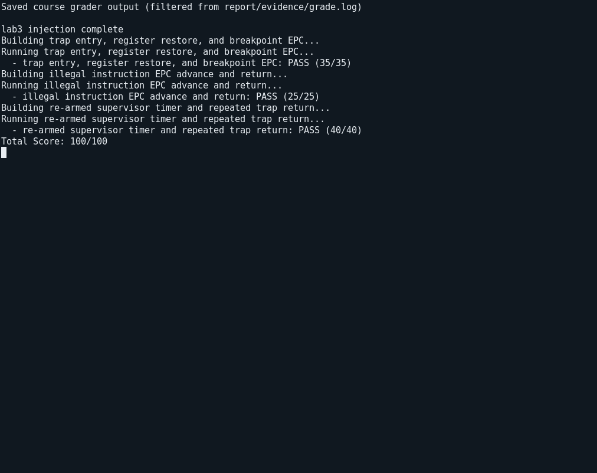
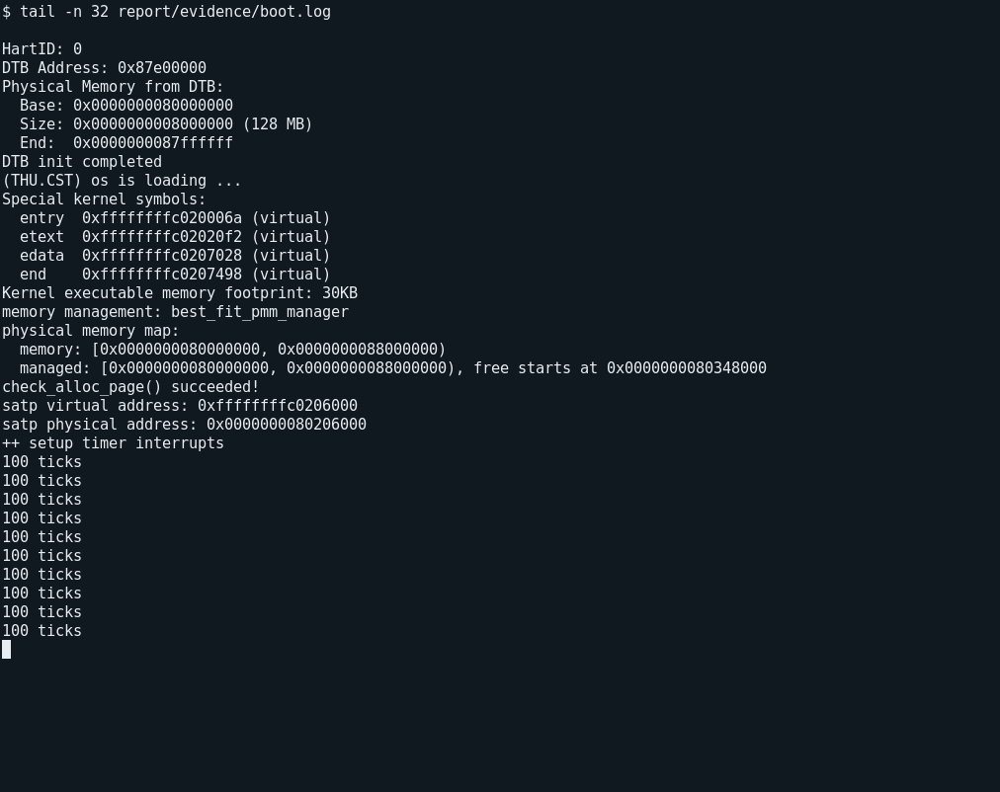
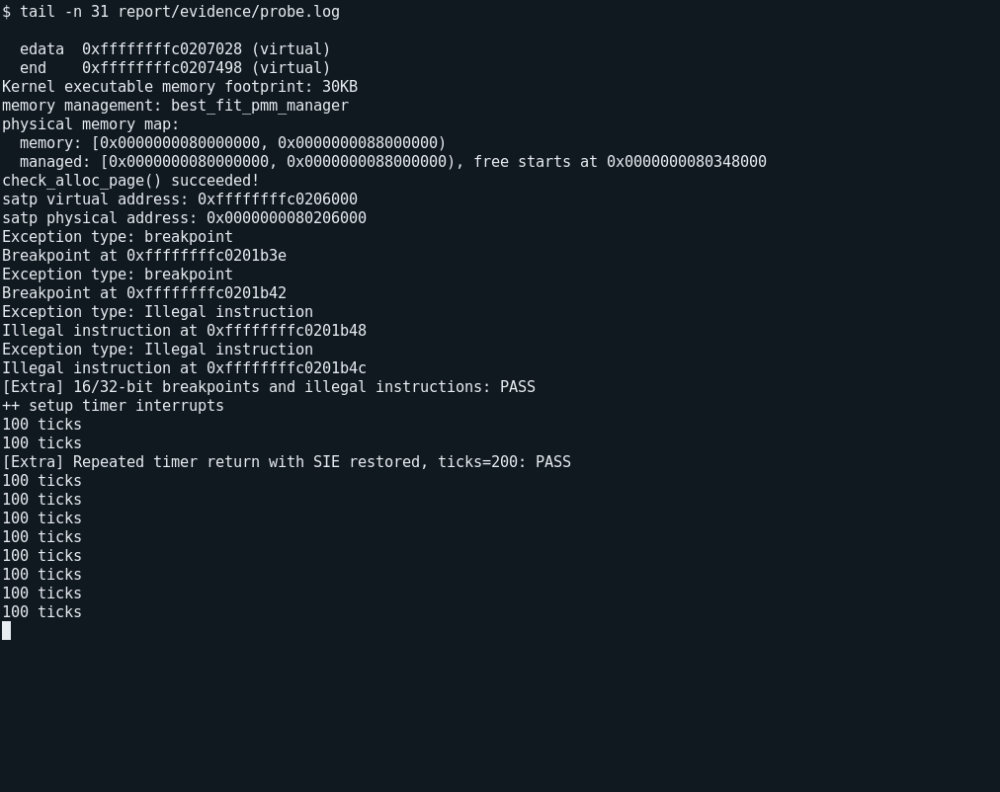

# Lab3：中断与异常处理实验报告

## 实验基本信息

| 项目 | 内容 |
|---|---|
| 实验名称 | Lab3：Trap 上下文保存与恢复、中断与异常处理 |
| 小组成员 | 龙李宽-2413077、王艺霖-2410824、郭嘉睿-2413174 |
| 完成日期 | 2026-11-03 |
| 代码与报告 | `lab3` 分支的 `code/`、`report/` |

### 小组分工

| 成员 | 负责的练习／模块 | 实验报告分工 |
|---|---|---|
| 龙李宽-2413077 | 功能模块一：Trap 上下文恢复与入口，负责 `RESTORE_ALL`、`__alltraps`，核对陷阱帧布局与寄存器恢复 | 整理第三节整体逻辑、第四节 4.1 的模块说明、规格与提示词，以及上下文恢复验证结果 |
| 王艺霖-2410824 | 功能模块二：中断与异常处理，负责时钟重设、计数与关机，以及断点、非法指令和其他原因的分类处理 | 整理第四节 4.2 的实现、规格与提示词，汇总异常指令长度分析和时钟验证结果 |
| 郭嘉睿-2413174 | 实验集成与验证，负责 Lab2 依赖衔接、Docker 工具链、启动兼容性、课程评分及补充整机测试 | 整理实验环境、第四节 4.3 的问题与修正、第五节测试截图与证据，汇总第六节总结 |

三位成员共同复核实验要求、复现运行结果并检查最终报告。
代码保留 `lab3` 标记，并填写小组三位成员学号。

## 一、实验目的

1. 理解陷阱（Trap）发生后硬件与软件各自承担的工作，建立完整的上下文恢复闭环。
2. 按实际陷阱帧（trap frame）布局，在汇编与 C 函数之间正确传递处理器状态。
3. 处理持续的时钟中断，以及能够跳过并继续执行的非法指令、断点异常。
4. 将自然语言规格落实为真实来宾机中的异常返回、寄存器保持和关机行为。

根据仓库中的教师调整说明，不实现、测试或讨论用户态／内核态切换 Challenge。

## 二、实验环境

| 项目 | 本次实际使用的配置 |
|---|---|
| 宿主与隔离环境 | Debian 13 宿主，Docker；镜像基于 `debian:trixie-slim` |
| 目标平台 | QEMU `virt`，单 hart，RV64，默认 128 MiB 内存 |
| 编译器 | `riscv64-unknown-elf-gcc` 14.2.0 |
| 模拟器 | QEMU 10.0.13，默认 OpenSBI 固件 |
| 调试器 | `gdb-multiarch` 16.3 |
| AI 编程工具 | Codex desktop |
| 底层模型及版本标识 | `gpt-6.1-sol`，由本次会话运行元数据确认 |
| 构建方式 | 课程 `code/Makefile`，根 Makefile 转发；不使用宿主 CMake 程序替代内核 |

[Dockerfile](../docker/Dockerfile) 提供工具链；[开发说明](../docs/lab3-development.md)
记录完整复现命令。工具版本、源码指纹和运行耗时见
[validation.json](evidence/validation.json)。

## 三、实验整体逻辑分析

### 3.1 本章的逻辑主线

本实验的关键不是“能进入异常处理函数”，而是处理后仍能正确继续被打断的程序。
硬件只保存少量控制状态，不会替软件保存全部整数寄存器，也不会自动换好内核栈。
因此实验按以下顺序构成闭环：

```text
正常执行
   │ 中断或同步异常
   ▼
硬件设置 sepc/scause/sstatus，转到 stvec
   ▼
__alltraps → SAVE_ALL → a0 = sp → trap(tf)
                                      │
                   ┌──────────────────┴─────────────────┐
                   ▼                                    ▼
        interrupt_handler(tf)                 exception_handler(tf)
        重设时钟、计数、输出                    分类、诊断、调整返回位置
                   └──────────────────┬─────────────────┘
                                      ▼
                 __trapret → RESTORE_ALL → sret
                                      ▼
                               恢复原执行流
```

异步中断不需要跳过原程序指令；非法指令与断点则必须跳过已处理的触发指令，
否则 `sret` 会再次执行它，形成异常循环。

### 3.2 与 Lab2 的衔接

Lab3 骨架的 `page_init()` 和 Best-Fit 分配器尚未填写，直接构建不能完成。
本次从远端 Lab2 的 `8f7daa9` 复用已有实现，继续使用 Best-Fit，不引入 Buddy、
SLUB 等额外模块。保留 Lab3 在页分配接口中新增的中断关闭与恢复逻辑，
也不修改课程原有分配器测试。

启动入口还恢复了 Lab2 已有的分页过渡处理，确保进入 C 代码前能正确从物理地址
跳到内核高半区（higher half）。这属于实验依赖衔接，不是新增实验题目。

## 四、实验内容与实现

### 4.1 功能模块一：Trap 上下文恢复与入口

**负责人：** 龙李宽-2413077。

**实现位置：** `code/kern/trap/trapentry.S` 中的 `RESTORE_ALL`、`__alltraps`。

#### 数据布局与调用关系

`SAVE_ALL` 在当前内核栈上分配 `36 × REGBYTES`，本次 RV64 共 288 字节：

| 槽位 | 内容 | 恢复时的处理 |
|---|---|---|
| 0 | `x0` | 恒为零，无须写回 |
| 1 | `ra` | 恢复被打断代码的返回地址 |
| 2 | 原始 `sp` | 从 `sscratch` 间接保存，必须最后恢复 |
| 3—31 | 其他整数寄存器 | 对应原槽位恢复 |
| 32 | `sstatus` | 写回控制与状态寄存器（Control and Status Register, CSR） |
| 33 | `sepc` | 写回处理函数可能修改的返回位置 |
| 34、35 | `stval`、`scause` | 保留供诊断，不需要写回来完成返回 |

`__alltraps` 执行 `SAVE_ALL` 后，将当前 `sp` 放入 `a0`，符合 RISC-V
调用约定（calling convention）的第一个参数规则，再调用 `trap(tf)`。
C 函数返回后沿同一路径进入 `__trapret`。

恢复过程先使用临时寄存器装载并写回 `sstatus`、`sepc`，然后恢复整数寄存器。
`sp` 必须最后装载：若提前恢复，它将不再指向陷阱帧，后续所有栈偏移都会错误。
288 字节也是 16 的整数倍，不破坏进入 C 函数所需的栈对齐。

`sret` 根据保存的 `SPP` 返回监督态，并通过 `SPIE` 恢复中断使能；
不是简单地执行普通函数的 `ret`。软件不需要重新打开 SIE 才能返回。

#### 最终提示词与规格

完整工作提示词保存在 [prompt.md](prompt.md) 的 Module 1。本模块按四段组织：

- **[PROMPT]**：只完成入口与恢复，保留已有保存逻辑和公开接口。
- **[RELY]**：提供实际的 36 槽布局，特别说明槽 2 是中断前的 `sp`。
- **[GUARANTEE]**：交付 `RESTORE_ALL`、`__alltraps`、`__trapret` 返回路径。
- **[SPECIFICATION]**：C 收到真实帧地址，帧中的返回状态被采用，全部可写整数
  寄存器恢复，最后恢复 `sp`，不添加已取消的 Challenge。

#### 实现迭代

上下文恢复实现首次整机验证即通过了课程寄存器测试。构建时发现框架沿用旧 CSR
名称 `sbadaddr`，新汇编器报 `unknown CSR 'sbadaddr'`。在文件开头将它映射为
同一 CSR 的现行名称 `stval`，保留 `SAVE_ALL` 的指令文本和帧布局不变。

### 4.2 功能模块二：中断与异常处理

**负责人：** 王艺霖-2410824。

**实现位置：** `code/kern/trap/trap.c` 中的
`interrupt_handler(struct trapframe *tf)`、`exception_handler(struct trapframe *tf)`。

#### 中断处理

从 `cause` 中移除最高位中断标记后，根据原因码分类。监督态时钟中断按以下顺序处理：

1. 调用 `clock_set_next_event()`，安排下一次中断。
2. `ticks` 增加一次。
3. 每达到 `TICK_NUM=100` 的整数倍，调用原有 `print_ticks()`。
4. 输出次数达到 `SHUTDOWN_AFTER=10` 时调用 `sbi_shutdown()`。

骨架没有定义指导书提到的 `SHUTDOWN_AFTER`，因此本次补充为十次报告，即
1000 次时钟中断后关机。`clock.c` 的周期为 100000 个时间基准计数，在 QEMU
10 MHz 时间基准下约为 10 ms；正常运行约十秒后完成关机。

其他已识别的软件、时钟、外部中断输出类型提示。未知中断输出原因码及完整陷阱帧。
这保留了诊断信息，没有虚构未实现设备的确认或恢复流程。

#### 异常处理

非法指令和断点分别输出类型及 `tf->epc` 地址。两者共用指令长度判断：

```c
uint16_t instruction = *(const uint16_t *)tf->epc;
tf->epc += (instruction & 3) == 3 ? 4 : 2;
```

在本实验的 RV64GC 指令集范围内，低两位不为 `11` 的指令占 2 字节，否则占
4 字节。压缩指令扩展（Compressed Extension）中的 `C.EBREAK` 和普通 `EBREAK`
虽然触发同一异常原因，但长度不同，因此不能单纯按异常类型固定加 2 或加 4。
当前内核代码映射可读，可以从触发指令的首个半字读取长度。

其他异常调用 `print_trapframe(tf)`，不擅自改变返回位置。这里完成的是实验要求的
诊断，不是页故障恢复或通用的指令模拟。

#### 最终提示词与规格

完整提示词在 [prompt.md](prompt.md) 的 Module 2：

- **[PROMPT]**：补齐两个处理函数，使用框架提供的时钟、输出和关机接口。
- **[RELY]**：列出实际的 `IRQ_*`、`CAUSE_*`、`ticks` 和相关函数。
- **[GUARANTEE]**：保持处理函数签名和已有 `trap.c` 函数不变。
- **[SPECIFICATION]**：明确下一次时钟事件、单次计数、输出周期与关机条件；
  明确异常返回位置必须根据实际指令编码前进，其他原因输出完整帧。

### 4.3 整机集成中的问题与修正

**负责人：** 郭嘉睿-2413174。

| 观察到的问题 | 原因 | 解决方法 |
|---|---|---|
| 汇编报 `unknown CSR 'sbadaddr'` | 骨架使用旧名称 | 用局部别名映射为 `stval`，不改变保存布局 |
| OpenSBI 打印 `Domain0 Next Address: 0`，没有内核输出 | `-device loader` 只复制镜像，没有建立正确的内核交接 | 普通启动与评分脚本统一使用 `-kernel` |
| 改为 `-kernel` 后仍未进入 C | 启用 Sv39 后，仍在物理地址取下一条指令，但页表只映射高地址 | 临时恒等映射（identity mapping）物理启动位置，跳到高地址后撤销 |

课程评分脚本只调整了 QEMU 的加载参数，没有修改评分匹配规则、分值或来宾测试。
评分目录移到项目根目录的 `.temp/lab3-grade`，保留每个测试的输出，且不再清理
工作目录中的普通内核。这样测试不会把提交内核替换为注入测试的版本。

## 五、测试与验证

### 5.1 课程评分

执行 `make grade`，得到：

| 课程测试 | 实际结果 |
|---|---|
| Trap 入口、寄存器恢复、断点 EPC | 35/35 |
| 非法指令返回、中断与异常诊断分支 | 25/25 |
| 重设时钟事件、持续时钟与重复 Trap 返回 | 40/40 |
| **总分** | **100/100** |



完整构建与评分输出见 [grade.log](evidence/grade.log)，各测试原始来宾输出分别为
[上下文](evidence/grade-context.log)、[异常](evidence/grade-illegal.log)、
[时钟](evidence/grade-timer.log)。

### 5.2 普通内核启动到关机

验证脚本构建并启动未注入测试的内核，观察到物理内存初始化自检成功、十行
`100 ticks`，随后 QEMU 正常退出。退出来自内核 SBI 关机调用，而不是宿主超时。



原始输出：[boot.log](evidence/boot.log)。

### 5.3 补充的真实异常与时钟旅程

[验证脚本](../scripts/verify_lab3.py) 只在 `.temp/lab3-probe` 的副本中加入测试。
汇编探针按顺序执行以下真实指令，并在每次返回后增加 `a0`，最后检查结果为 4：

| 编码 | 指令／异常 | 预期 EPC 前进 |
|---|---|---|
| `0x9002` | `C.EBREAK` | 2 字节 |
| `0x00100073` | `EBREAK` | 4 字节 |
| `0x0000` | 非法压缩指令 | 2 字节 |
| `0x0000007b` | 未实现的 32 位自定义操作码 | 4 字节 |

探针还检查早期异常前后 SIE 都保持关闭、`sscratch` 为零。随后正常启用中断，
在至少 200 次时钟中断之后检查 SIE 已恢复，并继续完成第十次报告和正常关机。
这既补足了课程测试对两种指令宽度的覆盖，也验证了多次 Trap 后仍可继续执行。



完整输出：[probe.log](evidence/probe.log)；验证摘要：[verify.log](evidence/verify.log)。

### 5.4 GDB 检查真实陷阱帧

在真实时钟中断进入 `trap()` 时，批处理 GDB 检查得到：

- `sizeof(struct trapframe) = 288`；
- 帧地址为 `0xffffffffc0205ed0`，保存的 `sp` 为 `0xffffffffc0205ff0`，差值 288；
- `a0` 与帧地址相同；
- `cause = 0x8000000000000005`，确为监督态时钟中断；
- `sscratch = 0`。

复现脚本：[lab3-timer.gdb](../scripts/lab3-timer.gdb)，原始输出：[gdb.log](evidence/gdb.log)。

截图均由真实 X 终端显示已保存的运行日志后截取，不是实时调试截图；生成方式见
[capture_lab3.sh](../scripts/capture_lab3.sh)。

## 六、实验总结与收获

### 6.1 与操作系统原理的对应

| 实验知识点 | 对应原理 | 本实验中的具体体现 |
|---|---|---|
| 上下文保存／恢复 | 中断对被打断代码应尽量透明 | 任意时刻被打断，全部整数寄存器仍需保持，不仅是 C 的被调用者保存寄存器 |
| 中断与异常分类 | 异步事件与同步故障 | 时钟不跳过原指令；已处理的非法指令和断点需要跳过 |
| 特权状态恢复 | 硬件与内核分工 | 软件恢复 CSR，`sret` 根据 SPP、SPIE 完成返回 |
| 定时中断 | 时间管理与抢占的基础 | 每次安排下一事件；本实验没有进一步实现调度 |
| 临界区 | 共享数据更新期间的中断控制 | 页分配接口关闭并按原状态恢复本 hart 的中断 |
| 地址空间建立 | 物理地址与虚拟地址的转换 | 开启分页不自动改变 PC，启动阶段必须显式过渡 |

本实验未覆盖多核同步、进程调度、用户栈切换、系统调用完整生命周期、缺页恢复及
外部设备驱动。它建立了这些机制以后可以依赖的内核中断处理基础。

### 6.2 AI 协作开发的经验

1. 汇编任务的规格首先应明确帧布局和恢复顺序，而不是仅写“恢复全部寄存器”。
2. 不能把异常原因码等同于指令长度；使用统一编码判断可以消除特殊分支。
3. 编译成功不足以说明整机可用。OpenSBI 交接、开启分页后的取指、Trap 返回
   和最终关机必须连成真实运行旅程检查。
4. 复用 Lab2 时保留 Lab3 的中断保护，按接口衔接，而不是整文件覆盖。
5. 提示词、实际输出、测试副本和普通提交内核分开保存，方便复现与讲解。

### 6.3 参考资料

- [RISC-V Supervisor ISA](https://docs.riscv.org/reference/isa/v20260120/priv/supervisor.html)：CSR 与监督态返回规则。
- [RISC-V C 扩展](https://docs.riscv.org/reference/isa/v20260120/unpriv/c-st-ext.html)：压缩指令编码。
- [QEMU virt 文档](https://www.qemu.org/docs/master/system/riscv/virt.html)：内核加载与设备树交接。
- [MIT xv6：Traps and system calls](https://mit-pdos.github.io/xv6-riscv-book/trap.html)：硬件、汇编入口、C 处理及返回的分层解释。
