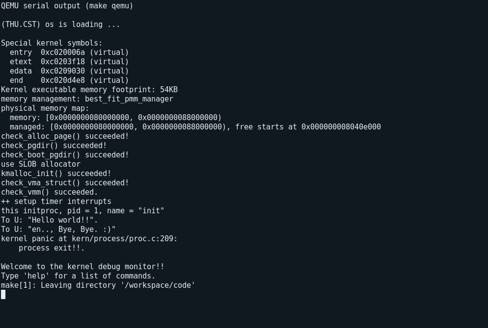
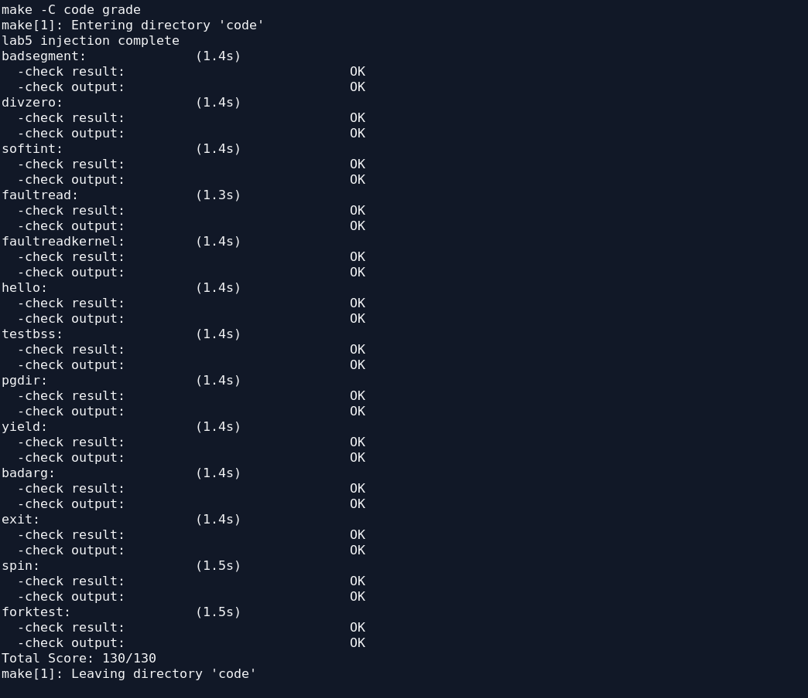

# Lab4：虚拟内存页操作与内核线程实验报告

| 项目 | 内容 |
|---|---|
| 小组成员 | 龙李宽-2413077、王艺霖-2410824、郭嘉睿-2413174 |
| 完成日期 | 2026-11-17 |
| 实验平台 | Docker（Debian trixie）；QEMU 10.0.13 `virt`，RV64，单 hart，128 MiB |
| 工具链 | GCC 14.2.0、GDB 16.3、默认 OpenSBI 1.6 |
| AI 工具 | Codex Desktop；规格与提示词见[提示词文档](prompt.md) |

交付按页表、线程创建、调度与集成验证分块；代码实验标记保留小组三位成员学号。

## 一、目标与整体逻辑

本实验的目标是让已能管理物理页、响应陷阱的内核，进一步创建并运行内核线程。
首先复用 Lab2 按设备树初始化物理页与最佳适配分配器；再用页表建立内核可访问的地址空间。
Lab3 的陷阱返回除了服务中断，也成为新线程进入 S 态的跳板。

```text
内核启动 → 物理页与页表自检 → 陷阱入口与 VMM 初始化
         → 将启动现场登记为 idle → 创建可运行的 init
         → schedule → proc_run → switch_to
         → forkret → forkrets → __trapret → sret → kernel_thread_entry → init_main
```

## 二、核心实现与规格

| 模块 | 规格如何落到实现 |
|---|---|
| 虚拟内存页操作 | 把引用数定义为页持有的映射引用。对新映射取得引用；同一页改权限时不动引用；跨页替换、撤销时先改叶项并同步地址翻译，再放旧引用。删除不存在的地址是空操作。 |
| 进程创建 | 区分尚未发布的资源和已经可调度的线程。先完成 PCB、内核栈、陷阱帧（trap frame），再在关中断区间分配 PID、登记并唤醒。错误按资源获取的逆序清理。 |
| 调度 | 链表决定选谁，`proc_run` 安装下一线程，`switch_to` 只负责寄存器。下一线程要么从上次调用续跑，要么沿造好的返回链首次进入。 |

### 1. 页表与物理页生命周期

页表项（page table entry，PTE）把虚拟页映射到物理页，物理页描述符则记录引用。
例如，地址 A、B 共指向物理页 X 时，X 有两个映射引用；把 B 改到 Y 后，X 仍因 A
而存活。即使 B 已不再引用 X，也必须等修改同步到本核地址翻译后才能归还最后一个引用，
以免地址转换后备缓冲区（translation lookaside buffer，TLB）还命中旧翻译。

`get_pte` 按 Sv39 的两级中间索引定位最末层槽位。根项缺失时，先构造好下面两层再发布；
第二次物理页分配失败就回收第一张、尚未可见的页表。启动高半区是独立的 1 GiB 叶映射；
4 KiB 页表槽位查找遇到它时不再向下走。启动自检直接核对这个叶项，另用低地址 4 KiB
别名执行真实读写。在真实访存中，调用者须传合法 Sv39 叶权限；
课程夹具使用的 `W=1,R=0` 仅用于检查位模式，不拿该项访存。

### 2. 从 PCB 到第一次运行

`alloc_proc` 把 PCB 初始化为未发布状态。PID 0 的 idle 不是从 fork 得到的：它已经在
启动栈上运行，第一次被换出时才有需要保存的上下文；其余线程各自持有两页内核栈。
`copy_mm` 只保留接口，本实验内核线程共享启动页表。

新线程的调度上下文令第一次 `ret` 到达 `forkret`。随后从内核栈恢复陷阱帧：
`sepc` 指向 `kernel_thread_entry`，`s0` 是函数地址，`s1` 是参数。
陷阱帧放在栈顶下方，调度开始使用的 `sp` 指向帧底；`sret` 后线程使用的是
陷阱帧中保存的栈顶。这两个栈指针承担不同职责，不能混填。

### 3. 选择线程、切换现场

`schedule` 从当前节点的后继开始，绕过哨兵，扫描一圈；idle 从表头开始，
没有可运行线程就选 idle。选中的线程运行次数加一，选中自身时不切换。
`proc_run` 在关中断期间更新 `current`；当物理页表根改变时才写 Sv39 `satp` 并刷新本核翻译。
本实验线程共享页表，因此评分实际覆盖的是**同一地址空间下的寄存器和栈切换**，
没有覆盖跨页表根的运行路径。

`switch_to` 保存和加载 `ra/sp/s0–s11`；它遵循调用边界，无需替 C 调用者保存临时寄存器。
[Linux 的 RISC-V 切换汇编](https://code.googlesource.com/linux/torvalds/linux/+/21e4675d9305f6ccd20b95d943882d607c8ae288/arch/riscv/kernel/entry.S)
也把被调用者保存寄存器和陷阱入口拆开；生产内核另处理任务指针和更完整的架构状态。

## 三、规格与提示词迭代

提示词以「任务、依赖、保证、具体规格」四段组织，按模块钉住各自的接口和不变量：
页表模块强调发布、栅栏与引用数；创建模块说明 ABI（application binary interface，应用二进制接口）
以及资源所有权何时交给进程表；调度模块明确链表边界、寄存器顺序与页表根的单位。
完整内容见[提示词文档](prompt.md)。

| 集成中实际遇到的问题 | 修正与反馈 |
|---|---|
| GCC 14 拒绝把 SLOB 中的整数内核地址直接传给 `kva2page(void *)`。评分夹具的测试线程回调也声明成了 `void`。 | 分别在转换处显式转为指针、把回调改为规定的 `int` 返回类型；不改评分条件。 |
| 普通启动第一次只到 OpenSBI，交接地址是 0。 | 复用 Lab3 的 `-kernel` 交接与临时恒等映射，再跳转到高半区并撤销恒等项；评分和普通启动走相同入口。 |
| 软件页表断言通过后，内核卡在低地址别名访存检查。 | 对照 Sv39 规范，将框架的中间项从 `V|U` 改为只设 `V`，更新相应非叶项断言；保留叶项 `U` 检查，别名读写随后通过。 |
| 框架的 `do_exit` 会打印 panic 并进入监控器。 | 这是现有退出桩：它发生在 `init_main` 打印并返回之后，保留该行为。没有把它改成虚假的成功退出，也没有把退出与回收列为已实现功能。 |

## 四、扩展练习

### 1. 局部关中断怎样恢复

`local_intr_save(flag)` 读取 `sstatus.SIE`；若之前已开，则清掉 SIE 并记录真，
否则记录假。 `local_intr_restore(flag)` 只有在标志为真时才重新开中断。
因此内层临界区在外层关中断的情况下不会误开；这只作用于本核，并不是多核互斥锁。
线程切换时，仍在栈上的那个 C 调用保存了自己的标志；新线程则由 `sret` 用
`SPIE` 建立初始 SIE。

### 2. 为什么多级页表遍历看起来重复

| 分页模式 | 虚拟页索引 + 页内偏移 | PTE 宽度 | 叶项可表示的页大小 |
|---|---|---|---|
| Sv32 | 10 + 10 + 12 位 | 4 字节 | 4 KiB、4 MiB |
| Sv39 | 9 + 9 + 9 + 12 位 | 8 字节 | 4 KiB、2 MiB、1 GiB |
| Sv48 | 9 + 9 + 9 + 9 + 12 位 | 8 字节 | 4 KiB、2 MiB、1 GiB、512 GiB |

每一级都用一段虚拟页号索引当前页表，读出有效位并判断是叶项还是下一层指针。
只有走到叶项才结束：高层叶项把低位索引也当作页内偏移，物理基址必须按大页大小对齐。
Sv39 为普通 4 KiB 映射走两次相同的中间步骤，所以原框架的两段代码相似。
位宽、模式与栅栏语义可参见 [RISC-V 特权架构手册](https://github.com/riscv/riscv-isa-manual/blob/main/src/priv/supervisor.adoc)。

本实验保留一个 `get_pte(..., create)` 入口：查找和创建共享索引与叶项判断，不维护两套遍历；
把分配与清零提取成独立辅助函数，并将发布留在遍历逻辑里处理回滚。
如果以后有多个分页模式、大页拆分或并发页表更新，再考虑把纯读取接口与修改事务分开。

## 五、整机验证

在仓库根目录运行：

```sh
docker build -t os-labs:lab4 -f docker/Dockerfile docker
docker run --init --rm -it --user "$(id -u):$(id -g)" \
  -v "$PWD:/workspace" os-labs:lab4 make qemu
docker run --init --rm --user "$(id -u):$(id -g)" \
  -v "$PWD:/workspace" os-labs:lab4 make grade
```

实际复用同一 Dockerfile 已构建的 `os-labs:lab3` 镜像。终端截图来自真实输出回放。
[普通启动日志](evidence/boot.log)展示物理页、页表和 VMM 自检，以及 PID 1 的问候。
[课程评分日志](evidence/grade.log)为 **30/30**；
[注入版来宾串口](evidence/grade-guest.log)包含 `[Test PMM] PASS`、
`[Test Process Create] PASS` 和 `[Test Schedule] PASS`，最后一项验证两个内核线程
多次主动让出 CPU，无需依赖时钟抢占。





## 六、总结

- **内存管理：** 映射是页表对物理页的持有关系，TLB 同步决定旧页何时能真正复用。
  本实验只做本核栅栏；未覆盖多核 TLB 广播失效（TLB shootdown）、写时复制或按需调页。
- **执行上下文：** 完整陷阱帧用于恢复任意被打断的现场；调度上下文利用函数调用约定，
  只需保存切换后还会用到的寄存器。第一次运行则主动合成一个可恢复现场。
- **调度与生命周期：** “可运行”是队列可见的状态，不等于正在 CPU 上执行；
  本实验演示协作式切换，未实现时间片抢占、用户态隔离、进程退出后的回收和等待。
- **AI 协作：** 把提示词从“实现函数”推进到“说清状态、所有权和硬件约束”更有用。
  页表的案例尤其直观：软件能检查到一个位，并不意味着硬件会接受那个页表项。
