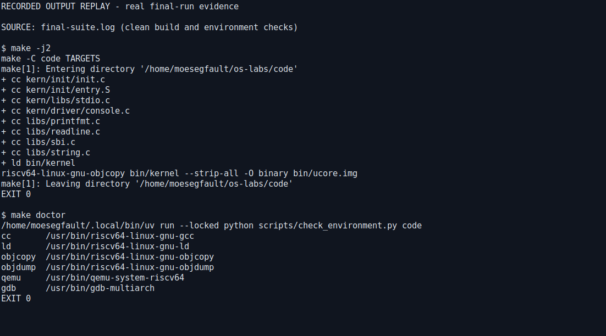
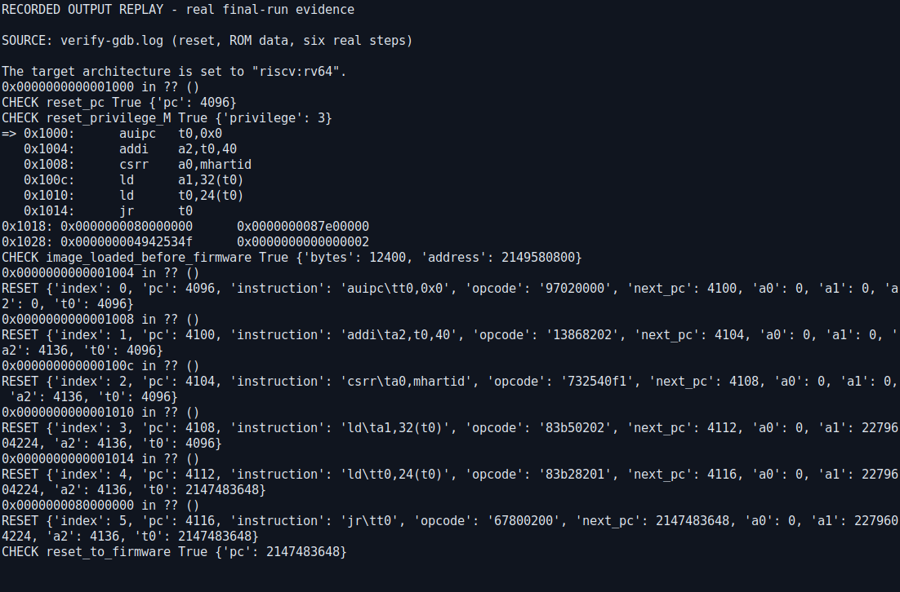
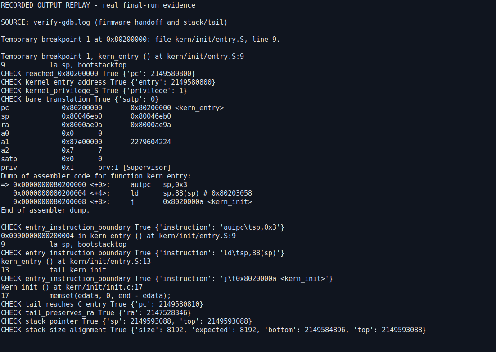
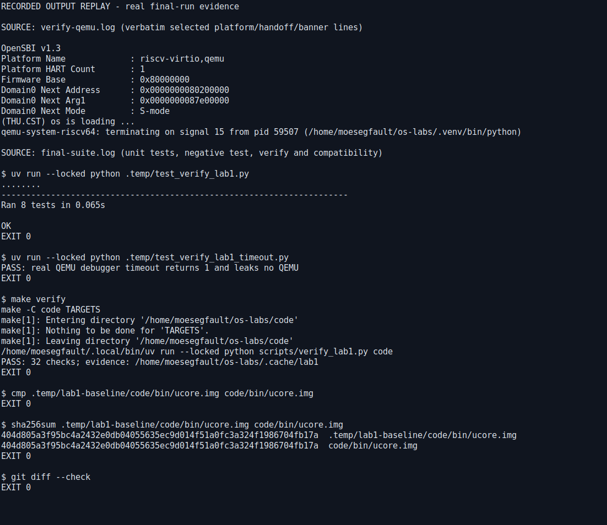

# 操作系统实验报告

## 实验基本信息

| 项目 | 内容                                      |
| --- |-------------------------------------------|
| **实验名称** | Lab 1：比麻雀更小的麻雀（最小可执行内核） |
| **小组成员** | 郭嘉睿、王艺霖、龙李宽                    |
| **完成日期** | 2026-10-01                                |

### 小组分工

| 成员           | 实验分工 | 报告分工 |
|----------------| --- | --- |
| 2413174-郭嘉睿 | 负责练习一，分析内核启动入口、启动栈、链接布局，以及 `kern_entry` 到 `kern_init` 的执行流程 | 负责实验整体逻辑分析和练习一，整理反汇编、符号地址及 RISC-V 调用约定分析 |
| 2413077-龙李宽 | 负责练习二，使用 QEMU 和 GDB 验证复位流程、OpenSBI 交接、特权级和寄存器状态 | 负责练习二，整理调试步骤、运行记录、关键寄存器状态和截图 |
| 2410824-王艺霖 | 负责构建环境、自动验证、兼容性检查、证据整理和 Git 交付 | 负责实验环境、测试与验证、实验总结，以及报告统稿、格式和提交检查 |

## 一、实验目的

1. 了解 RISC-V 内核的基本启动流程。
2. 理解启动代码中设置栈指针和跳转到 C 函数的作用。
3. 学习使用 QEMU 和 GDB 跟踪内核启动，观察指令和寄存器的变化。

## 二、实验环境

| 项目 | 使用环境 |
| --- | --- |
| 操作系统 | WSL2，Ubuntu 24.04.5 LTS |
| 交叉编译器 | `riscv64-linux-gnu-gcc` 13.3.0 |
| 模拟器 | `qemu-system-riscv64` 8.2.2，`virt` 平台 |
| 调试器 | `gdb-multiarch` 15.1 |
| 固件 | OpenSBI v1.3 |
| 构建工具 | Make |

### AI 工具

| 成员   | AI 编程工具 | 底层模型  |
|--------| --- |-----------|
| 郭嘉睿 | Codex | GPT-6 Sol |

本次使用 AI 辅助阅读启动代码、整理调试结果和编写报告。实际任务提示词记录在 [prompt.md](prompt.md) 中。

## 三、实验整体逻辑分析

本实验的重点是理解一个最小内核如何开始运行，不涉及进程管理、内存分配等后续功能。整体流程如下：

```text
编译、链接内核，生成镜像
        ↓
QEMU 启动，从 0x1000 执行复位代码
        ↓
跳转到 0x80000000，执行 OpenSBI
        ↓
跳转到 0x80200000，进入 kern_entry
        ↓
设置内核栈，跳转到 kern_init
        ↓
初始化数据、打印启动信息，进入循环
```

主要文件和函数的作用如下：

| 文件或函数 | 作用 |
| --- | --- |
| `code/tools/kernel.ld` | 指定内核的链接布局，起始地址为 `0x80200000` |
| `code/kern/init/entry.S` | 内核汇编入口，设置栈指针并跳转到 C 函数 |
| `kern_init()` | 调用 `memset` 清零未初始化数据区，打印启动信息，最后进入无限循环 |
| `cprintf()` | 格式化输出启动信息 |
| `sbi_console_putchar()` | 通过监管者二进制接口（Supervisor Binary Interface，SBI）请求固件输出字符 |

先设置栈再进入 C 函数，是因为 C 函数执行时需要使用栈。内核完成基本初始化后，便可以通过 OpenSBI 输出启动信息。

## 四、实验内容与实现

### 练习一：理解内核启动中的程序入口操作

入口代码的关键指令为：

```asm
kern_entry:
    la sp, bootstacktop
    tail kern_init
```

#### 1. `la sp, bootstacktop` 完成什么操作？目的是什么？

这条指令将 `bootstacktop` 的地址放入栈指针（Stack Pointer，SP）寄存器 `sp`，为内核建立自己的启动栈。这里取得的是标签的地址，不是该地址处的数据。

本实验启动栈大小为两页，每页 4096 字节，共 8192 字节。调试时观察到：

| 项目 | 地址 |
| --- | --- |
| 栈底 `bootstack` | `0x80201000` |
| 栈顶 `bootstacktop` | `0x80203000` |
| 执行完 `la` 后的 `sp` | `0x80203000` |

栈向低地址增长，用于保存函数执行所需的局部数据和寄存器。设置好 `sp` 后，后续 C 函数才能正常使用内核栈。

`la` 是伪指令（pseudoinstruction），不一定对应一条机器指令。本次反汇编中，它展开为两条指令，因此单步两次后才能观察到最终的栈指针值。

#### 2. `tail kern_init` 完成什么操作？目的是什么？

这条指令将控制权转移到 `kern_init`，开始执行 C 语言编写的初始化代码。与普通函数调用不同，它不会设置新的返回地址，属于尾调用（tail call）。

`kern_init` 最后进入无限循环，不需要返回到汇编入口，因此这里使用 `tail`。本次反汇编中，这条伪指令最终表现为一条跳转指令 `j`。

### 练习二：使用 GDB 验证启动流程

#### 1. 调试过程

在仓库根目录编译内核：

```sh
make
```

打开两个终端，分别启动 QEMU 调试模式和 GDB：

```sh
# 终端一
make debug

# 终端二
make gdb
```

连接后，使用以下命令查看初始位置和指令：

```gdb
info registers pc
x/6i 0x1000
si
```

重复使用 `si` 单步执行，观察程序计数器（Program Counter，PC）及相关寄存器的变化。执行完复位代码后，PC 到达 `0x80000000`，开始运行 OpenSBI。

随后设置内核入口断点，继续执行：

```gdb
b *0x80200000
continue
info registers pc sp
x/3i $pc
```

程序在 `kern_entry` 停下。继续单步执行设置栈的指令，可以看到 `sp` 变为 `0x80203000`；再执行跳转指令，就进入 `kern_init`。

#### 2. 加电后最初几条指令位于哪里？完成哪些功能？

在本次 QEMU `virt` 环境中，CPU 最初从 `0x1000` 开始执行。这里是 QEMU 提供的复位代码，其前六条指令如下：

| 地址 | 指令 | 主要作用 |
| --- | --- | --- |
| `0x1000` | `auipc t0,0x0` | 将当前地址放入 `t0`，作为后续访问数据的基准 |
| `0x1004` | `addi a2,t0,40` | 设置固件启动信息的地址 |
| `0x1008` | `csrr a0,mhartid` | 读取当前硬件线程编号，本次为 0 |
| `0x100c` | `ld a1,32(t0)` | 读取设备树（Device Tree）地址 |
| `0x1010` | `ld t0,24(t0)` | 读取 OpenSBI 入口地址 `0x80000000` |
| `0x1014` | `jr t0` | 跳转到 OpenSBI |

这些指令主要准备启动参数，并将控制权交给 OpenSBI。OpenSBI 完成初始化后，再进入地址为 `0x80200000` 的内核入口。

本次还观察到，复位时 CPU 处于机器模式（Machine mode，M-mode）；到达内核入口时，已切换到监管者模式（Supervisor mode，S-mode）。

#### 3. 调试中需要注意的地方

指导书建议通过 `watch *0x80200000` 观察内核装载。但本次使用 QEMU 的 `-kernel` 参数时，内核镜像在 CPU 开始执行前就已放入内存，因此没有观察到 OpenSBI 向该地址写入镜像的过程。使用入口断点可以直接观察固件向内核的交接。

## 五、测试与验证

已有运行记录显示，内核编译成功，QEMU 输出了预期的启动信息：

```text
(THU.CST) os is loading ...
```

GDB 调试确认了复位地址、OpenSBI 入口、内核入口和启动栈的变化。补充的 `make verify` 自动检查也通过了，原始输出保存在 [evidence/](evidence/README.md) 中。

本实验源码没有提供 `tools/grade.sh`，因此没有 `make grade` 的评分结果。另外，本次编译产物的未初始化数据区（BSS，Block Started by Symbol）为空，报告不将其记为实际清零了非空数据区。

以下截图展示的是已保存运行输出的终端回放。

**编译结果：**



**复位代码与单步调试：**



**内核入口与启动栈：**



**启动输出与检查结果：**



## 六、实验总结与收获

### 1. 实验知识与操作系统原理的联系

| 实验知识点 | 对应的操作系统原理 | 联系与区别 |
| --- | --- | --- |
| 内核镜像与链接地址 | 程序装载 | 理解代码需要放在指定位置才能执行；本实验尚未涉及用户程序的装载 |
| OpenSBI 向内核交接 | 特权级 | 观察到从机器模式进入监管者模式，但尚未实现用户态系统调用 |
| 设置启动栈 | 函数调用与执行环境 | C 函数依赖有效的栈；本实验只有一个启动栈，不涉及进程切换 |
| SBI 字符输出 | 输入输出 | 内核借助固件打印信息，没有自行实现完整的设备驱动 |

本实验尚未涉及的重要内容包括页表和虚拟内存、进程调度、中断处理以及文件系统。这些需要在后续实验中继续学习。

### 2. AI 协作经验

AI 可以帮助解释汇编指令和整理调试步骤，但仍需要结合源码、反汇编和实际输出核对。例如，不能把伪指令直接当作一条机器指令，也不能把指导书中的通用说明直接当作本次运行结果。

通过本实验，理解了内核启动并不是直接执行一个 C 函数，而是需要先经过固件交接、设置栈等准备步骤，再进入内核初始化代码。
